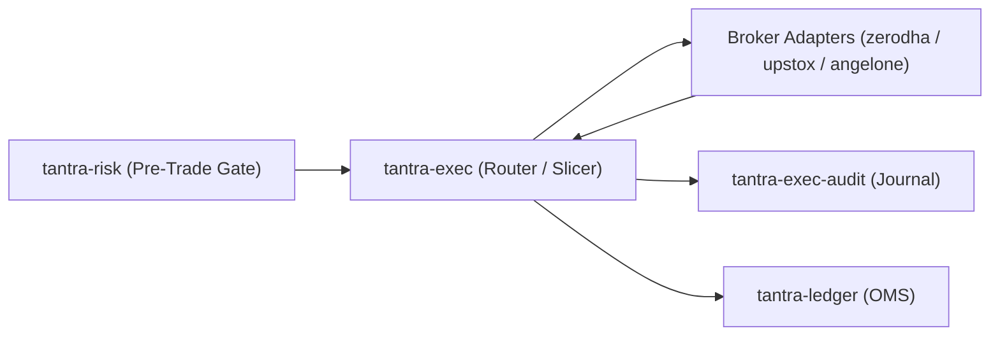

# `tantra-exec` — Execution Bounded Context Architecture

> Tier 2B execution gateway (ported from `honba-te`). Bridges the pre-trade risk
> gate (`tantra-risk`) and domain OMS (`tantra-ledger`) to live Indian broker
> execution APIs. Zero floats in every financial path (`rust_decimal::Decimal`).

## 1. Bounded Context & Responsibility

`tantra-exec` is the **Execution Hand** of the Tantra event pipeline:



It owns: canonical broker execution ports (`BrokerExecutor`, `ExecutionStream`),
a strict-priority token-bucket rate limiter, SEBI freeze-quantity slicing and
iceberg/TWAP execution algorithms, a resilient multi-broker Smart Order Router
(SOR) with health circuit breakers and OTR balancing, headless TOTP session
auth, and a tamper-evident audit journal.

## 2. Workspace Topology

The gateway is a Cargo workspace of **eight crates** (no facade crate — the
workspace itself is the gateway):

| Sub-Crate | Role | Public Surface |
| :--- | :--- | :--- |
| `tantra-exec-core` | Canonical ports & shared machinery | `BrokerExecutor` trait v2, `IcebergOrderExecutor`, `RiskGatedExecutor`, `MockBrokerExecutor`, `ExecutionStream`/`BrokerExecutionEvent`, prioritized `TokenBucketRateLimiter`, `RateLimitedBroker`, `ProductType` taxonomy, exact wire/`decimal` helpers, `BrokerEnumMap` wire tables, `BrokerError` taxonomy, Prometheus/OTel telemetry |
| `tantra-exec-auth` | Headless session & TOTP auth | RFC 6238 `Totp` (SHA-1/SHA-256), credential stores (env/memory/keyring), headless login flows, `SessionTokens`/`TokenCache`/`SessionManager`, 08:30 IST `DailyRefreshScheduler`, CDSL eDIS pre-authorization |
| `tantra-exec-slicer` | Order slicing engine | `FreezeLimitCatalog` (builtin NIFTY/BANKNIFTY caps), `FreezeLimitSlicer` + `SlicePlan`, native/synthetic iceberg, TWAP scheduler, deterministic jitter |
| `tantra-exec-router` | Smart Order Router | `ResilientRouter` (cost/latency/pinned policies), `HealthTracker` circuit breakers, `OtrLedger` balancing, legacy `SmartOrderRouter` + `ExecRouter` |
| `tantra-exec-audit` | Regulatory audit journal | SHA-256 hash-chained fsynced JSONL segment WAL, Parquet compaction, 17-column SEBI Annexure CSV, `tantra-audit-export` CLI |
| `tantra-exec-zerodha` | Kite Connect v3 adapter | REST executor (place/modify/cancel, order book, positions, margins), postback webhook listener, Kite Ticker order stream, native iceberg |
| `tantra-exec-upstox` | Upstox v2 adapter | REST executor (place, read-then-patch modify, cancel, order book, positions, funds), portfolio RSS WebSocket order feed |
| `tantra-exec-angelone` | Angel One SmartAPI adapter | **Stub only** — placeholder module + empty integration test (see `docs/gaps/0001-angelone-adapter.md`) |

All crates depend on `tantra-core` (canonical `OrderRequest`, `OrderAck`,
`FillReport`, `InstrumentId`, `Price`, `Quantity`, `Money`, ...) and
`tantra-exec-core` (ports); `tantra-exec-core` additionally depends on
`tantra-risk` (`RiskEngine` / `RiskRefusal`).

## 3. Canonical Ports & Wrapping Layers

Execution adapters implement the unified [`BrokerExecutor`] trait (v2:
`place_order`, `cancel_order`, `modify_order`, `health_check`,
`fetch_order_book`, `fetch_positions`, `fetch_margins`,
`get_order_status`-as-fallback). Two generic wrappers compose over any adapter:

```text
RiskGatedExecutor<E>  ── mandatory pre-trade tantra_risk::RiskEngine check
    ▼
RateLimitedBroker<E>  ── per-broker token bucket, priority-ordered waiting
    ▼
<broker adapter E>    ── REST + push stream (postback / WebSocket)
```

Lifecycle events arrive over push streams (`ExecutionStream` →
`BrokerExecutionEvent::OrderAck | Fill | OrderCancelled | OrderRejected`),
never status polling alone.

## 4. Domain Purity & Determinism

* **Explicit clock**: planning functions (`FreezeLimitSlicer::plan`,
  `TwapPlan::build`, `native_leg_count`) and router health/OTR logic take an
  injected `DateTime<Utc>` — no clock queries inside domain logic.
* **Zero floats**: every price/quantity/margin path is
  `rust_decimal::Decimal`; wire serialization uses exact decimal strings
  (`format_fixed_exact` rejects tick-misaligned values instead of rounding).
* **Exact wire decoding**: broker JSON floats never reach the domain layer —
  `wire::decimal_from_json` round-trips through serde_json's shortest text.
* **Deterministic routing**: token-bucket grant cadence and TWAP jitter are
  deterministic given the same inputs (same seed, same start).

## 5. Key Architectural Decisions

| Decision | Where | Note |
| :--- | :--- | :--- |
| Audit journal is fsynced JSONL segment WAL, **not** SQLite WAL | `tantra-exec-audit/src/journal.rs` | Deliberate deviation (sqlx/sqlite unavailable in the exec build); the runtime's `SqliteAuditLedger` is the complementary operational SQLite store. See `docs/gaps/README.md` (gap 0002 closed) |
| Angel One adapter is a stub | `crates/tantra-exec-angelone/` | `docs/gaps/0001-angelone-adapter.md` |
| Risk gating lives in `tantra-exec-core::RiskGatedExecutor` and legacy `SmartOrderRouter`; the v2 `ResilientRouter` keeps risk upstream | `executor.rs`, `router` | Wrapping layers stay composable |
| Table-driven wire-token mapping (`BrokerEnumMap`) | `tantra-exec-core/src/wiring.rs` | Adding a broker or token means editing a table, not match arms |

## 6. Testing

All tests live in `tests/` parallel to each crate's `src/` — no in-file
`#[test]` blocks. Coverage includes token-bucket invariants, TOTP RFC 6238
vectors, freeze/twap/iceberg property tests, router failover/health/OTR tests,
audit hash-chain tamper tests, and per-adapter wire-mapping/payload tests.
Mutation tests exist for `core` and `slicer`.

## Related

* `tantra-core` — shared kernel value objects and wire contracts.
* `tantra-risk` — deterministic pre-trade risk gate.
* `tantra-ledger` — OMS consuming execution events and fills.
